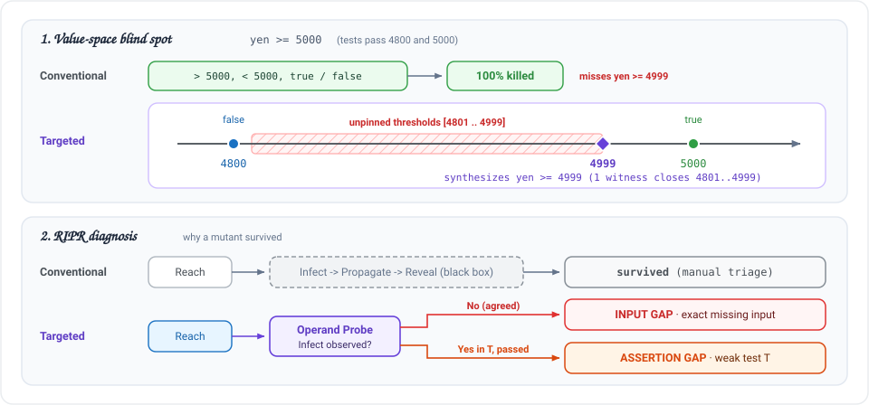
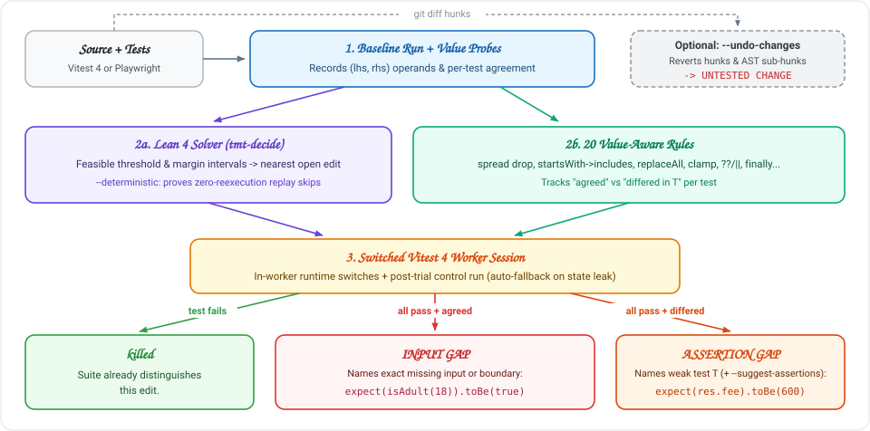

# targeted-mutation

[](https://www.npmjs.com/package/targeted-mutation)
[](https://github.com/t-k/targeted-mutation-ts/actions/workflows/ci.yml)
[](LICENSE)

**Targeted mutation testing for JavaScript and TypeScript**: `targeted-mutation` finds the tests your suite is missing. It watches the values your tests actually pass through comparisons, tries the smallest wrong implementation those values cannot tell apart from yours, and prints the test that would catch it.

```ts
export const isAdult = (age: number) => age >= 18;
// tests check isAdult(20) and isAdult(10)
```

```text
src/cart.ts:15:45  survived  comparison-boundary/v1: >= -> >
src/cart.ts:15:45  survived  comparison-threshold/v1: replace with 17

Test gaps:
INPUT GAP src/cart.ts:15:45
  operands (18, 18): original true, edited false
  suggested test: expect(isAdult(18)).toBe(true)
INPUT GAP src/cart.ts:15:45
  operands (17, 18): original false, edited true
  suggested test: expect(isAdult(17)).toBe(false)
```

A conventional mutation run replaces `>=` with `>` or `<`. It does not try `age >= 17`, the nearest implementation that the inputs 10 and 20 leave open. The [shipping threshold experiment](docs/development.md#shipping-threshold-experiment) compares both approaches on the same suite.

## Why Targeted Mutation Testing?

Conventional mutation testing treats the test suite as a black box: it enumerates fixed syntactic templates (`>=` → `>`, `+` → `-`, `{ ... }` → `{}`), re-runs tests against every mutant, and returns a list of survivors. That architecture carries three structural limits that Targeted Mutation Testing addresses directly by recording runtime operand observations during the baseline run:

- **Finds value-level gaps that syntactic mutators structurally miss.** Fixed syntactic templates cannot cover a numeric or value space. In the [shipping threshold experiment](docs/development.md#shipping-threshold-experiment), tests with ¥4,800 and ¥5,000 kill 100% of StrykerJS mutants on `yen >= 5000`, yet `yen >= 4999` still passes. By observing the actual operands flowing through comparisons, Targeted Mutation Testing computes the closed interval of observationally feasible thresholds (or variable-RHS margins) and synthesizes the nearest undistinguished alternative directly—producing a single boundary witness that rules out every feasible wrong threshold on that side.
- **Disambiguates `survived` along the RIPR model.** A conventional `survived` verdict conflates two different failures: no test reached a state infection, or infection occurred but was never revealed by an assertion. Because runtime operands are recorded, Targeted Mutation Testing separates **`INPUT GAP`** (no test passed a distinguishing input, naming the exact missing input) from **`ASSERTION GAP`** (naming the exact test whose input diverged at the expression without failing, with concrete assertion suggestions via `--suggest-assertions`).
- **Reduces cost algorithmically, not just by parallelizing runs.** Rather than paying `O(M · T)` re-executions across blind syntactic mutants, Targeted Mutation Testing shrinks the candidate set, skips provably identical deterministic comparison trials via `tmt-decide` (extracted from Lean 4 proofs), and amortizes Vitest 4 and 5 worker startup:

| Cost dimension | Conventional | Targeted Mutation Testing |
|---|---|---|
| Threshold gap search (width `W`) | Not searched (`O(W · T)` by enumeration) | **`O(1)`** trial (synthesized from observed operand extrema) |
| Deterministic comparison trials (`M`) | `O(M · T)` (re-runs every mutant) | **`O(M_div · T)`** (`tmt-decide` skips provably identical trials) |
| Runner/environment setup (`S`) | `O(M · (S + T))` (isolated re-runs) | **`O(S + M · T)`** (in-worker switches; [3–6× faster](docs/performance.md#mutation-runs-compared-with-strykerjs) on `--mutators full`) |
- **Focuses on unguarded behavior, not syntactic noise.** Combining value-aware semantic rules with diff-level reversion (`--since REV --undo-changes`, down to individual added `&&`/`||` terms and object properties) tests the degrees of freedom your suite actually leaves open.



## How it works (and how it differs from conventional mutation testing)

During the baseline run, `targeted-mutation` records the runtime values flowing through your code, synthesizes the smallest undistinguished edits from those observations, and classifies every survivor into an actionable test gap.



| Capability | Conventional mutation testing | `targeted-mutation` |
|------------|-------------------------------|---------------------|
| Mutant generation | Fixed syntactic templates only | Observation-guided synthesis (nearest open integer threshold and variable-RHS margin via Lean 4) + 20 value-aware semantic rules (spread property drop, `startsWith`/`endsWith` to `includes`, `replace`/`replaceAll`, clamp bounds, literal-set pruning, `??`/`\|\|`, `finally` cleanup drop, etc.) |
| Survivor diagnosis | `survived` (developer must investigate manually) | Separates **`INPUT GAP`** (no test passed a distinguishing input, naming the exact missing input) from **`ASSERTION GAP`** (names the exact test that had the input and asserted nothing) |
| Assertion guidance | None | `--suggest-assertions` runs weak calls, weak `expect(...)` expressions, and end-of-test local state snapshots (Proxy stores, DOM elements, callback variables) in a warm Vitest session and prints concrete assertions (`expect(res.fee).toBe(600)`, `expect(store.dirty).toBe(true)`, `expect(container.children[0].style.transform).toBe("translateY(20px)")`) |
| Diff-based testing | Mutate changed lines only | `--since REV --undo-changes` also reverts each changed Git hunk and independent AST sub-hunk (added `&&`/`\|\|` terms, added object properties) to find `UNTESTED CHANGE` |
| Deterministic replay | Re-executes every mutant | `--deterministic` skips eligible comparison trials whose recorded safe-integer operands prove identical outcomes, verified by `tmt-decide` (extracted from Lean 4 proofs) |
| Worker isolation | Shared worker or full restart per mutant | In-worker Vitest 4 and 5 runtime switches with an immediate post-trial control run; automatically falls back to a fresh run if worker state leaks |

## Install

```sh
npm install --save-dev targeted-mutation
```

Requirements:

- Node.js 22.18 or later in the 22 line, or 24.11 or later.
- [Vitest](https://vitest.dev/), [Playwright](https://playwright.dev/), or Node's built-in `node:test` runner (`--runner node`, requires no extra test runner package). Releases are tested with Vitest 4 and 5, Playwright 1.65, and `node:test` on Node 22 and 24.
- Any platform supported by Node.js, including macOS, Linux (glibc and musl/Alpine), and Windows. On macOS (arm64, x64), Linux with glibc (arm64, x64), and Windows (x64), npm installs the matching prebuilt binary package automatically as an accelerator for extraction and Lean-checked replay. On other platforms, `analyze` and `extract` fall back automatically to the bundled TypeScript parser and JavaScript threshold evaluator.

The tool copies the project to a temporary directory and runs the project's own test code and configuration there. Run it only on code you trust, as you would run the test suite.

## Use

```sh
npx targeted-mutation analyze                      # every source file in the current project (default: targeted)
npx targeted-mutation analyze . src/cart.ts        # selected files
npx targeted-mutation analyze --lines src/cart.ts:10-40
npx targeted-mutation analyze --since origin/main  # edits on lines changed since a revision (also flags weakened tests)
npx targeted-mutation analyze --since origin/main --undo-changes  # also: which changes do the tests pass without?
npx targeted-mutation analyze --suggest-assertions # also: the exact value a weak assertion should compare with
npx targeted-mutation analyze --mutators full      # full built-in StrykerJS-compatible mutation set (no StrykerJS required)
npx targeted-mutation analyze --list --shard 0/4   # preview candidates for CI shard 0 of 4 without running tests
npx targeted-mutation analyze --format sarif       # emit SARIF 2.1.0 for GitHub Code Scanning (or --format jsonl)
npx targeted-mutation analyze --write-baseline tmt-baseline.json  # save stable finding IDs
npx targeted-mutation analyze --baseline tmt-baseline.json        # suppress already-recorded findings
npx targeted-mutation analyze --checkpoint .tmt-checkpoint.jsonl  # resume interrupted runs safely
npx targeted-mutation analyze --runner node --test 'test/*.test.mjs' . src/app.mjs  # run directly against Node's built-in node:test runner
npx targeted-mutation analyze --exclude-rule nullish-equality/v1 --copy-exclude-gitignore --test 'src/lib/**/*.test.ts'
```

`tmts` is a short alias for the same command. `targeted-mutation --help` lists every option.

The exit status is 0 after a completed analysis, including one that reports gaps, and 1 when the suite fails before any edit, a file cannot be parsed, or the arguments are invalid.

### Reading the report

Each line is one source edit and what the suite did with it:

| Status | Meaning |
|--------|---------|
| `killed` | A test failed on the edit. The suite distinguishes it. |
| `survived` | Every test passed on the edit. A `Test gaps` entry shows the missing input. |
| `unreached` | No test executed the edited expression. |

A test gap gives the operand values that separate your code from the edit and, for an exported single-argument function, a ready assertion under `suggested test`.

On a terminal the report is text. When the output is piped or redirected it is JSON with a `schemaVersion`, so scripts can rely on it. `--format text` or `--format json` selects one explicitly.

### Profiles

| Option | What it edits |
|--------|---------------|
| (default) `--mutators targeted` | `<`, `<=`, `>`, `>=` boundaries and, on Vitest, integer thresholds across constant-RHS comparisons plus variable-RHS margin shifts (`comparison-margin/v1`) and twenty value-aware rules: an equality that every test leaves true or false, an operand of `&&`, `\|\|` or `??` whose value never decides, `??` written as `\|\|`, `== null` written as `=== null`, another arithmetic operator, `Math.min` for `Math.max`, another rounding, the other end of a list, a numeric sort without its comparison, a call that is no longer awaited, a copy that is the original, a single dropped property in an object spread update, `startsWith`/`endsWith` relaxed to `includes`, `replace` swapped with `replaceAll`, a dropped `Math.min`/`Math.max` clamp bound, a pruned literal element in `[...].includes(x)`, swapped `{ ...a, ...b }` merge precedence, `every` swapped with `some`, dropped `^`/`$` regex anchors on `.test(s)`, and a skipped cleanup call inside `finally`. In a Vitest session with operand recording, each survivor is reported with the missing input or with the tests that had the input and asserted nothing. On Playwright (or when Vitest falls back to source rewrites without operand recording), edits run without operand recording, and Playwright reports survivor diagnostics only when paired with a `--spec` witness. Needs no extra package. |
| `--mutators full` | Everything in `targeted` (comparison boundaries, integer thresholds/margins, and all twenty value-aware targeted rules), plus the complete built-in mutation set: every StrykerJS mutator (arithmetic, equality, logical, conditional, boolean, string, array, object, block, arrow function, assignment, unary, update, method, optional chaining, regular expression and call removal). Needs no extra package. Runs in one switched session on Vitest 4 and 5, or one source rewrite per mutation with Playwright. |
| `--witnesses` | Value substitutions such as a neighbouring field, the first or last index, or a sort key, each confirmed by a test that tells them apart. Reports `No edit sites` when a file has no such pattern. |

`// Stryker disable`, `// Stryker restore`, and `// tmt:ignore <reason>` (same-line or standalone line above) comments exclude mutations in both the `targeted` and `full` profiles, with the reason recorded on each ignored mutation.

On Vitest 4 and 5 the mutations are decided inside running Vitest workers, several at a time, with a control run after each one. `--concurrency N` sets the number of workers, `--verify-trials N` re-runs a sample of those decisions in fresh Vitest runs, and `--isolated-trials` starts a fresh Vitest run for every mutation instead; see [How mutations run on Vitest](docs/analysis.md#how-mutations-run-on-vitest).

`--deterministic` declares that the suite runs from the same state every time. Recorded comparison values then decide eligible comparison trials without re-running the tests, and each such decision is checked by `tmt-decide`, an executable extracted from a Lean 4 proof (with JavaScript instrumentation, observation collection, and test identity in the trusted runtime boundary). `--audit` re-runs those trials against the rewritten source and reports any disagreement.

The [analysis guide](docs/analysis.md) covers scope selection, specifications, Playwright projects and the witness profile in detail.

## Documentation

- [Analysis guide](docs/analysis.md)
- [Parser grammar and trust boundary](docs/l1.md)
- [Performance measurements](docs/performance.md)
- [Development and verification](docs/development.md)
- [Releasing](docs/releasing.md)

## Prior work

The idea of generating mutants from test observations is known as *test-aware mutant generation*. Related lines of work include SEMu (symbolic execution to kill surviving mutants), DSpot (assertion amplification), the W-method (complete test suites for finite state machines), and Meta's ACH (LLM-generated mutants with tests that kill them). `targeted-mutation` occupies the **SMT-solver-free, AI-free** corner of that space: record the runtime trace and solve the feasible interval directly (checked by `tmt-decide`, extracted from Lean 4 proofs). Rather than chasing raw mutation scores across tools with different mutant sets, it optimizes for catching real bugs per minute of CI time.

## Other languages

- **Rust**: [t-k/targeted-mutation](https://github.com/t-k/targeted-mutation)
- **Go**: [t-k/targeted-mutation-go](https://github.com/t-k/targeted-mutation-go)
- **Python**: [t-k/targeted-mutation-python](https://github.com/t-k/targeted-mutation-python)
- **Swift**: [t-k/targeted-mutation-swift](https://github.com/t-k/targeted-mutation-swift)

## License

[Apache-2.0](LICENSE). Third-party notices are in [NOTICE](NOTICE).
